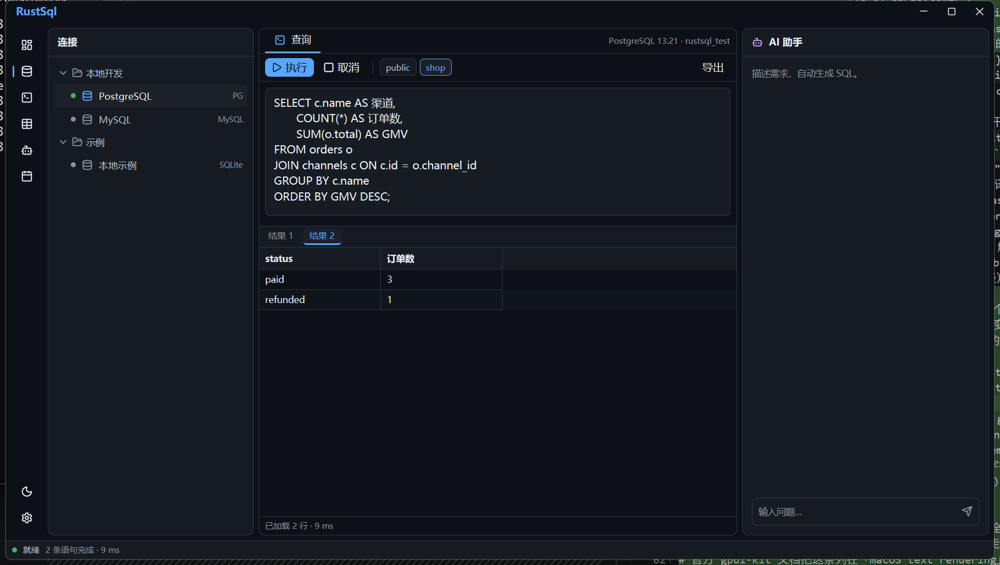

# RustDb

跨平台数据库管理软件：Rust + GPUI，支持 MySQL / MariaDB / PostgreSQL / SQLite / SQL Server / Oracle，内建 AI Agent。

> 当前阶段：**M0–M5 全部完成，M6（v1.1 效率增强）进行中 —— 增量 2：选区复制、DML 预览、运行记录条、历史筛选与落盘、SQL 文件、参数面板、X-02 分页与表分页下钻已落地**。
> 六方言驱动齐备（SQLite / PostgreSQL / MySQL / MariaDB / SQL Server 已连通验证，Oracle 已实现但本机无实例），
> 数据编辑与表设计器可用，AI Agent 带风险分级与确认卡；M6 已就位 DML 预览（含工具栏入口）、
> 结果网格多选、运行记录条、历史来源/时间筛选、SQL 参数、脚本切分、SQL 文件打开/保存与错误位置换算。



## 快速开始

```bash
cargo run -p rustdb
```

启动后在左侧连接树里点一下数据源节点即可连接（无独立「连接/重连」按钮），再点「执行」。

### 连接本机 Docker 数据库

```bash
docker run -d --name rustdb-pg \
  -e POSTGRES_PASSWORD=rustdb -e POSTGRES_DB=rustdb_test \
  -p 55432:5432 postgres:13

docker run -d --name rustdb-mysql \
  -e MYSQL_ROOT_PASSWORD=rustdb -e MYSQL_DATABASE=rustdb_test \
  -p 53306:3306 mysql:8.0
```

```powershell
$env:RUSTDB_DEV_DB="1"      # 显示「本地 PostgreSQL/MySQL」开发连接
$env:RUSTDB_DEMO="pg"       # 自动连接 PostgreSQL（1=SQLite, mysql=MySQL）
$env:RUSTDB_DEMO_SCHEMA="shop"
cargo run -p rustdb
```

> 开发连接的口令只在内存里（`dev_secret`，`#[serde(skip)]`），不写盘。生产路径走 keyring。

## 已实现

### M6（v1.1，增量 1/3：契约 + 纯逻辑）

- **能力位增补**（`db-api::Capabilities`）：`dml_preview` / `routine_source_edit` / `routine_dependencies` /
  `partition_admin` / `server_side_filter` / `foreign_key_pivot` / `explain_visual`，全部 `#[serde(default)]`，
  旧 JSON 反序列化为 `false`（不静默降级）。当前开启：`dml_preview`（六方言）、`server_side_filter`（SQLite）、
  `foreign_key_pivot`（SQL Server / Oracle）。
- **SQL 参数（F-62）**：`?` / `:name` / `${name}` / `#{name}` / `@name` 识别（跳过字符串、注释、引用标识符），
  `::` 类型转换与 `@@version` 不误判；T-SQL / MySQL 自动关闭 `@name`；`@set name = value` 脚本变量提取。
  执行前弹出参数面板：逐项填值、类型可自动推断或循环切换（文本/数字/布尔/NULL/原始 SQL/列表），
  原始 SQL 参数需二次确认后才拼接；渲染后的 SQL 才提交，原始语句用于错误定位。
- **脚本切分（F-64）**：`GO`（含 `GO 5`）、MySQL `DELIMITER`、PostgreSQL `$tag$` 块、CRLF，输出 1-based 行号；
  纯注释片段不产出语句。
- **错误定位与诊断（F-61）**：`LineIndex` 做字节偏移 ↔ 行列换算（CRLF、Tab、多字节）；驱动错误位置（PostgreSQL
  `position`）落到出错字符，状态栏「跳到错误」把光标送过去。编辑器内做**宽容语义校验**：未知表 / 未知列 / 未知别名
  给波浪线，动态 SQL、元数据缺失、未覆盖语句标注「无法完全校验」，从不阻止执行；悬停表名 / 列名显示类型、主键、注释。
- **DML 预览（F-63）**：`UPDATE` → `SELECT *, e1 AS "a(new)" … FROM t [WHERE …]`；`DELETE` → `SELECT * …`；
  `INSERT … VALUES` → `SELECT … UNION ALL SELECT …`。只读零写入（构建器内断言 + 集成测试验数据未变）；
  多表 UPDATE / `INSERT … SELECT` / `DEFAULT` 显式降级；`NOW()`、`RANDOM()`、`NEXTVAL` 等给「预览值可能不同」提示。
  工具栏「预览」直接出只读结果，顶部标注「预览 · 只读」，`(new)` 列用强调色区分。
- **运行记录（F-65）**：每次执行一条记录（不覆盖旧结果），结果区顶部记录条可回看、固定、关闭；
  `ResultStore` 增加固定、释放、按内存预算淘汰（跳过固定 / 流式写入 / 本次运行的结果集）。
  **流式预算**：单条结果集写入时逐批校验字节上限，超限立即停流、标记截断并上抛告警，
  不再等整条查询物化完才淘汰；流式途中只在全局超额时淘汰未固定且已完成的旧结果。
- **事件丢失恢复**：会话 Actor 维护 `active_query` / `tx` 的实时快照；UI 收到广播
  `Lagged` 时据此校正标签页运行态与事务态，并在该标签消息面板留痕，不再永久停在「正在执行」。
- **历史增强（F-68）**：来源（手动 / AI / MCP / CLI / 文件）、影响行数、日期范围 + 来源 + 固定筛选、
  保留条数可配；历史面板已接来源 / 时间下拉；JSONL 落盘到数据目录 `history.jsonl`，启动恢复（未完成执行丢弃、损坏行跳过）。
- **导出与复制格式（F-72）**：TSV / CSV / JSON / Markdown / SQL INSERT·UPDATE / **Excel（XLSX，超单表自动拆 sheet）**，
  **公式防护**（只防护 `= @ TAB CR` 与非数字的 `+ -` 开头文本，`-5` 这类负数原样保留）、
  NULL 与空串区分、SQL 批量双上限（500 行 / 2MB）、**流式写盘**（`Core::export_result_to` 按页拉取）；
  工具栏「导出 ▾」直接选格式、同菜单还能「复制为」TSV/JSON/Markdown/SQL 到剪贴板，
  SQL 导出复用「打开表」的表名与主键。
- **单元格多选**：点选 / Shift 扩展 / 拖拽框选；页脚显示「已选 N 行 × M 列」，「复制选区」与
  「复制为」只取选区子矩阵（按当前排序/筛选后的显示顺序），SQL UPDATE 若选区缺主键列则拒绝并说明。
- **数据导入（F-74）**：对象右键「导入数据…」→ CSV / TSV / JSON / NDJSON / INSERT 字面量；编码自动识别
  （BOM → UTF-8 → GBK）或手动指定；首行表头、跳过行、去空白、空串转 NULL、每批行数、追加 / 清空（清空需二次确认）。
  默认按列名映射（对不上按位置），可逐列切换目标列；预检拦截生成列、重复映射、必填列缺失与类型不符，
  分批执行、单批失败继续并给出失败行区间（结果区「消息」页签）。Excel 需 `calamine`，当前提示另存为 CSV。
- **SQL 文件（F-64）**：工具栏打开 `.sql` 进新标签（同一文件复用标签）、保存写回原路径 / 无路径时另存为；
  整文件按语句串行执行、遇错即停，状态栏实时显示 `文件 · 第 i/n 条` 并给出 `文件 · 语句数 · 行数 · 耗时` 汇总；
  失败后状态栏出现「继续」，从失败语句之后接着跑（已执行语句不回滚），历史来源标记为「文件」；
  取消后保留已执行结果，状态栏给出成功 / 中断 / 未执行计数，消息面板标出未执行语句及行号。
  侧栏「文件」面板可浏览目录树：只列目录与 `.sql`，逐层展开，点文件名直接进标签。
- **服务端分页契约（X-02）**：`db-api::PageRequest`（页码 1 起、默认 200 / 上限 5000、多列排序与 AND 过滤）
  + `Session::fetch_page`；排序显式 `NULLS LAST/FIRST`、主键去重后兜底、多取一行探测 `has_more`。
  SQLite 参照实现已接通（`server_side_filter = true`）：双击表直接按页取数，页脚可翻页、切页大小（100/200/500/1000），点表头把排序下推并回到第 1 页；其余方言沿用默认 `Unsupported` 等待铺开。
- **单元格详情增强（F-80）**：JSON 支持格式化 / 压缩与路径定位（`/a/b/0`，也接受 `a.b.0`）；
  二进制在「十六进制 ↔ 文本」间切换；时间戳显示本地与 UTC；图片（PNG / JPEG / GIF / BMP / WebP）与
  EWKB 几何给出格式、尺寸 / SRID 元数据；标题栏显示原生类型、可空、大小与只读标记。格式化只影响显示。
- **对象置顶与快速定位（F-84）**：侧栏「对象」面板顶部搜索框按**名称与注释**过滤；置顶对象固定在最上，
  其后是「最近」区（按连接记录、最多 12 个，置顶项不重复）；置顶 / 最近 / 分组展开状态按连接写入
  `object_state.json`，重启后恢复，多连接互不覆盖。
- **AI 执行前安全审查（F-98）**：`core::review` 对 AI 生成的 SQL 做本地静态审查（词法级，不依赖模型自检）：
  多语句、无顶层 WHERE 的 UPDATE/DELETE、只读连接写入直接拒绝；`EXPLAIN ANALYZE` 按底层语句定级；
  DDL、REPLACE / MERGE、三段限定名、USE、账号 / 权限变更给出原因。命中项随确认卡展示并写入审计。
- **生产连接与临时写解锁（F-89）**：连接可标记「生产」，连接行与状态栏常驻红色徽标；执行 SQL、单元格提交、
  导入、迁移共用同一写闸门，未解锁时一律拦截。右键可临时解锁 1 / 5 分钟，连接行与状态栏显示倒计时，
  可立即回锁；断开或切换标记自动清除。AI 路径对生产写入始终拒绝，解锁只影响人工入口。
- **行操作与数据生成（F-71）**：网格底栏「行操作」菜单给出追加 1 行 / 追加 10 行 / 克隆选中行（主键留空交回
  数据库默认值）/ 粘贴 TSV（表头自动识别、空字段按 NULL）/ 数据生成器 / 设为数据库默认值 / 撤销本行变更。
  生成器表达式支持 `seq:1:1`、`int:1:100`、`date:2026-01-01:1`、`uuid`、`regex:[a-z]{8}`、`fk:列名`
  （候选值取当前结果），固定种子可复现；生成的新行其余列一律交回数据库默认值。`Esc` 依次关浮层、回退当前单元格、
  撤销未填写的新增行；无主键表禁止修改与删除。
- **外键跳转与按条件批量更新（F-73）**：选中带外键的单元格后，「外键」按钮直接跳到被引用记录（`NULL` 跳过，
  分页按方言：`TOP 200` / `FETCH FIRST 200 ROWS ONLY` / `LIMIT 200`）；「批量更新」面板按字段 / 运算符 / 值
  拼条件（10 种运算符，含 `IS NULL`），也可切到自定义 WHERE（拒绝注释、分号与多语句），AND / OR 任意组合。
  执行前先跑隐藏 COUNT 预览影响行数并给出完整 `UPDATE`，条件改过必须重新预览；真正执行要键入表名二次确认，
  并明确提示**未加载行无法生成可靠回滚 SQL**；成功后关闭面板并刷新当前页。
- **数据库文档生成（F-87）**：工具栏「文档」把当前库的表、列、索引、外键与关系汇总成 Markdown / DBML，
  **只读生成、不写数据库**；支持项目 / 表 / 列三级本地笔记并优先于库注释，笔记按连接存于 `doc_notes.json`。
  面板左栏编辑笔记与选择表 / 列，右栏实时预览 Markdown 与元数据警告；单次最多 300 张表，超出逐表警告。
  导出走另存为 + 后台原子写；缺详情、空列、出界外键与孤立笔记都会显式提示。
- **字段血缘（F-88）**：表对象右键「字段血缘…」按列聚合上游 / 下游并**分级给证据**：外键 = 确定，
  视图显式映射与历史 `INSERT … SELECT` / `UPDATE … FROM` = 高，同名字段 = 可能；每条边展示来源与置信度。
  面板可筛选字段与最低置信度，点击边行直接打开对应对象；单次最多 300 表 / 300 视图 / 100 条历史 SQL，
  截断与取详情失败都有警告；不覆盖应用层 / ETL / 存储过程中的隐式流转。
- **结构对比（F-86）**：工具栏双向箭头打开对比面板。源 = 参照快照（载入当前库或导入 JSON），
  目标 = 待修改库（可导出快照）；忽略表、重命名候选确认后才生成 `RENAME`；差异按新增 / 删除 / 修改 /
  一致列出。部署脚本默认**不执行**：先看影响与回滚建议，点两次才提交；`DROP` 默认关闭，
  PostgreSQL / SQLite / SQL Server 自动包事务；跨方言只按逻辑类型映射并显式警告。配置存 `compare.json`。
- **整库逻辑导出（F-76）**：工具栏下载入口打开导出面板，表清单默认全选，可逐表取消；结构、数据、
  其它对象、含 `DROP`、gzip、失败即中止均为独立开关。导出流式分页读取，写临时文件后原子替换，
  多库 / 多 Schema 可各写一个文件（`rustdb-dump-<秒>.sql[.gz]`，落在下载目录或 `RUSTDB_EXPORT_DIR`）。
  脚本可直接回放，头部明确提示**不是一致性快照**；面板按表显示进度与最终文件大小。
- **跨库数据传输（F-75）**：工具栏双向箭头打开传输面板，源 = 当前连接，目标 = 另一条连接配置，
  可多选表。模式支持建表 / 重建（重建前自动备份目标表，备份失败即中止）/ 追加 / Upsert；
  每批行数、单语句超时、大小写策略均可配。执行前必须先生成预览：逐表结构 SQL、列映射与警告，
  **预览不写目标**；选项 / 目标 / 表选择变化会让预览失效。逐表进度、行数与失败清单常驻面板；
  跨引擎只按逻辑类型映射并显式警告。目标临时建链、结束后释放，只读 / 生产写入门槛照旧生效。
- **数据对比与同步（F-78）**：工具栏复制入口打开面板，源 = 当前连接，目标 = 另一条连接配置，可多选表。
  按关键字段（留空 = 源表主键）逐行对比，生成 `INSERT / UPDATE / DELETE`；目标缺失行插入、非关键列
  变化更新、目标多出的行删除。`INSERT / UPDATE / DELETE`、大小写、每批行数、超时均为独立开关，
  先看差异脚本再同步；目标 / 选项 / 表选择变化会让预览失效。关键值为 `NULL` 或重复时跳过首行并显式
  警告，两侧列类型不一致也提示。对比只读，同步时目标写入门槛照旧；配置存 `data-compare.json`，可保存 /
  导出 / 导入。
- **三列布局对齐 RustShell**：侧栏 / 工作区 / AI 三列可拖拽，侧栏宽度**按面板分别记忆**
  （180–520，默认 260），AI 列 280–480（默认 360）；再点当前面板图标即收起侧栏，AI 标题栏 ✕ 收起、
  活动栏 Bot 重开，折叠不改宽度记忆；窗口窄于 1024 时侧栏自动让位。布局落 `layout.json`（原子写）。
  标题栏与活动栏取 `bg_elevated`、内容卡片统一 `bg_base`，状态栏 22px，列表 hover 比选中更淡。
- **例程源码查看与编辑（F-82）**：对象右键「查看 / 编辑源码」打开源码面板：SQL 语法高亮编辑、面板内搜索
  （上一处 / 下一处）、脏草稿离开前确认、「还原」回退到库里的原文。保存按方言生成包装语句：
  PostgreSQL / Oracle 用 `CREATE OR REPLACE`，SQL Server 视图 / 过程用 `CREATE OR ALTER`，
  MySQL 过程 / 函数 / 触发器与 SQLite 视图 / 触发器先 `DROP` 再 `CREATE`（**显式警告，依赖会丢**）。
  只读连接与不支持保存的方言（SQL Server 函数 / 触发器、物化视图）**显式降级**并写明原因；
  保存失败保留草稿与撤销历史。
- **Oracle 纯 Rust 驱动 spike（X-01）**：`db-oracle-rust` 用官方 `oracledb`（精确锁 `26.0.0-beta.4`，免 Instant
  Client）：专用 OS 线程独占同步连接、异步侧只等回执；NUMBER 走精确十进制、CLOB / BLOB、DATE / TIMESTAMP /
  TIMESTAMP WITH TIME ZONE 映射与现有驱动同口径；无旁路中断，取消维持 `None` 并以 `set_call_timeout` 兜底。
  元数据未移植、未注册到 app，live 往返等实例环境。
- **SSH 隧道增强 + 连接配置管理（F-91 / F-02）**：连接配置可**增删改并落盘**（`%APPDATA%\RustDb\connections.json`，
  临时文件 + rename 写入）；连接面板标题栏「+」新建、右键「编辑 / 删除」。隧道按**用户配置的顺序**逐层建链
  （私钥 → 私钥+口令 → 口令 → 无认证的有序回退链），本地开 `127.0.0.1:<随机端口>` 转发给目标库，驱动零改动。
  known_hosts 校验在**发送任何凭据之前**完成：密钥未知或变更都会弹出确认浮层（显示层号、端点、指纹、公钥，
  变更时附原记录），**接受**才写入 known_hosts 并重连，**拒绝**直接放弃；`Esc` 等同拒绝，绝不等于接受。
- **代理与局域网转发（F-91a）**：连接可叠加 **SOCKS5**（RFC 1928，支持用户名 / 口令认证，域名可交给代理解析）
  或 **HTTP CONNECT**（Basic 认证）代理；开了隧道时可选「代理 → SSH」或「SSH → 代理」，
  后者经 SSH `direct-tcpip` 通道再向代理握手。代理同样落成本地 `127.0.0.1` 转发，六种驱动不改。
  **代理口令只留在内存**；本地转发默认只绑回环，勾选「对局域网开放」才监听 `0.0.0.0`（界面红字警告）。
  失败信息带代理端点与所在阶段（先于 SSH / SSH 之后），不静默降级直连。
- **外部参考采纳**：RustGrid 评估结论已写入需求文档 19.13（Oracle `oracledb`、服务端分页、
  导入导出拆分、`rust-i18n`、`db-tunnel`）；顺带修掉 MySQL 池空闲连接永不回收的问题（`inactive_connection_ttl = 20s`）。
 

- **命令行工具（F-96）**：`rustdb-cli` 提供 `connections` / `schema` / `query` / `context` / `dump`
  五个子命令，与桌面端**共用 core**（驱动注册抽到 `bootstrap` crate，CLI 零驱动依赖）。
  全局 `--json` 输出机器可读信封，`--format csv/tsv/markdown` 走 `core::export` 的同一套编码。
  **默认只读**：写语句要 `--write`，危险语句（`DELETE` / `DROP` / `TRUNCATE` / 无 `WHERE` 的改删）
  再加 `--danger`；**生产连接带开关也拒绝**（CLI 没有解锁窗口）。错误写 stderr，
  退出码稳定：`E_USAGE`=2、`E_CONFIG`=3、`E_CONNECT`=4、`E_PERMISSION`=5、`E_QUERY`=6、
  `E_TIMEOUT`=7、`E_IO`=8。口令只从 `RUSTDB_PASSWORD_<ID>` 环境变量读进内存，不落盘；
  上下文导出不含主机、账号与密钥引用。
- **AI SQL 优化与方言转换（F-92）**：工具栏「优化」提供解释 / 优化 / 改写 / 转换四种任务，可指定目标方言；
  模型结果与原文做**行级 diff**，逐段「采纳 / 跳过」后再「插入编辑器」或「新标签」，**全程不执行 SQL**。
  方言不兼容点由本地词法器确定性检查（`LIMIT` / 反引号 / `AUTO_INCREMENT` / `RETURNING` 等），
  字符串与注释里的同名词不误报；优化与 Agent 共用同一个 `LlmProvider` 与结构摘要。
- **AI 上下文与结果回填（F-93）**：`@表` / `@已存 SQL` / `@选区` 芯片把表结构、固定历史 SQL、编辑器选区
  作为**资料**注入（`<context>` 块 + 提示词声明，不执行其中指令）；单段超 4000 字符截断并标注。
  回答里的 SQL 围栏渲染成卡片：「应用」只写编辑器，「临时运行」仅放只读语句，「正式执行」开后台标签、
  **不抢焦点**，状态（试跑中 / 失败 / 完成行数与耗时）显示在块内；错误栏「AI 修复」把报错交给改写面板。
- **多模型配置与本地模型（F-94）**：AI 卡片「模型」打开配置浮层——8 个预设（OpenAI / DeepSeek / Moonshot /
  通义兼容 / 智谱 / Ollama / LM Studio / 本地 CLI）与自定义 OpenAI 兼容端点，可配认证头、额外请求头、代理、
  上下文窗口、temperature、最大轮次与重试；「测试」走 `GET /models` 并输出延迟与错误分类，
  「发现模型」只列聊天模型、点击即填入。配置存 `ai_models.json`，**密钥只留内存 / 环境变量**；
  本地 CLI Agent 从 stdin 读提示、stdout 取回答，只出文本不参与工具调用。保存后立即重建引擎。
- **对象依赖查看（F-83）**：例程源码面板新增「依赖 / 被依赖」页签，列出直接依赖的对象名、类型、Schema
  与依赖类别；悬停显示限定名与跨库来源，条目可点开——表 / 视图生成 SELECT 打开数据页，例程切换到源码面板，
  草稿未保存时先拦截。PostgreSQL 走 `pg_depend`，MySQL / MariaDB 走 `information_schema`，
  SQL Server 走 `sys.sql_expression_dependencies`，Oracle 走 `ALL_DEPENDENCIES`；SQLite 明确不支持。
  每侧最多 200 条，超出显式标记截断。
- **分区管理（F-85）**：表节点右键「分区管理…」（仅 PostgreSQL 显示）——列出策略、分区键与一级分区的边界 / 行数，
  支持新建、附加已有表、分离（可选 `CONCURRENTLY`）与删除分区；表单按范围 / 列表 / 哈希策略切换，
  范围与列表可选 `DEFAULT`；所有操作先出 DDL 预览再执行，失败保留面板并给出恢复建议。
  规划器在 `core::partition`，分区名与边界做严格校验；执行走既有 DDL 通道，同样受只读与生产写门控。
- **加密配置交换（F-90）**：连接面板头部入口把所选连接（可含 SSH 隧道引用）导出为配置文件——可选口令走
  Argon2id 派生 + AES-256-GCM 加密，留空则需二次确认后明文导出；**导出永不包含口令、私钥口令与密钥库引用**。
  导入先预览再勾选，按「名称 + 主机 + 端口」（SQLite 用文件路径）去重，冲突行不可勾选、不覆盖已有连接；
  也支持从 DBeaver `data-sources.json` 与 JDBC / URI 连接串生成草稿（丢弃口令与代理）。加解密与解析在
  `core::exchange`，UI 不做方言分支。

### M3 / M4 / M5

- **更名 RustDb**：crate 包名 `rustdb-*`、二进制 `rustdb.exe`、环境变量 `RUSTDB_*`、数据目录 `%APPDATA%\RustDb`；
  旧目录的 `connections.json` / `settings.json` 在首次启动时**复制**过来（不删旧目录）。
- **六方言**：新增 SQL Server（`tiberius` TDS）与 Oracle（`oracle` / ODPI-C）真实驱动，含元数据、分页、事务。
- **数据编辑**：双击单元格进编辑条，类型感知校验、NULL 与空串严格区分；待提交变更集按主键定位，
  **单事务提交**，逐语句比对影响行数实现乐观并发（冲突整体回滚）。
- **表设计器 + 迁移计划**：列增删改 → 有序 DDL + 破坏性标记；SQLite 改列不猜，明确报「需要重建表」。
- **AI Agent**：6 个工具（搜索 / 结构 / 采样 / 只读查询 / 执行计划 / 写入），只读自动执行、写操作挂确认卡，
  每次调用写审计；未配置模型端点时退回离线演示 provider（面板标注 `offline-demo`）。
- **崩溃恢复**：标签页 SQL 落到 `session.json`，下次启动回填并提示。
- **i18n 骨架**：`ui::i18n` 词条表 + `t(key)`，缺失回落 key 并告警。
- **打包脚本**：`scripts/package.ps1` 产出 `dist/RustDb-<版本>-windows-x64.zip`。

详见 [`docs/M3-验证报告.md`](docs/M3-验证报告.md) / [`docs/M4-验证报告.md`](docs/M4-验证报告.md) / [`docs/M5-验证报告.md`](docs/M5-验证报告.md)。

### M2

- **多语句执行**：`sql_lang::split_statements` 切分后整批交给会话 Actor，按顺序串行执行，每条产出独立结果集。
- **多结果集标签**：结果区上方 `结果 1 / 结果 2 …` 可切换；DDL/DML 无结果列时标签显示 `语句 N · M 行`（影响行数）。
- **执行选区**：编辑器里有选区时 `Ctrl+Enter` 只执行选区，否则执行全文。
- **串行化修复**：`SessionCmd::Execute` 改为在 Actor 内就地 `await`。原实现用 `tokio::spawn` 会把同一连接上的语句并发跑，事务语义无法保证。
- **取消旁路**：`Core::cancel` 不再排队，直接调驱动 `Session::cancel`（PG `CancelToken` / MySQL `KILL QUERY` / SQLite `interrupt`），长查询不会堵住取消。
- **结果网格**：列头点击切换「升序 → 降序 → 取消」，排序在客户端完成；单元格点击即复制。
- **列筛选**：表头漏斗 → 输入即时过滤，大小写不敏感、多列取交集。
- **单元格详情**：选中后点底栏「详情」或右键，看长文本 / JSON / 二进制转储。
- **CSV 导出**：导出当前结果的全部已加载行，顺序跟随当前排序；`RUSTDB_EXPORT_DIR` 可覆盖默认下载目录。
- **右键菜单（仿 Navicat）**：连接 / 库 / 对象三类节点，分组 + 图标 + 危险项红色，全部无菜单头；
  设计表 / 查看 DDL / 转储 SQL / 统计行数 / 维护表 / 重命名 / 清空 / 删除，破坏性动作二次确认。

### M1

- **PostgreSQL 驱动**：`tokio-postgres`，连接 / simple query / CancelToken 取消 / 事务 / `information_schema` 元数据 / `SET search_path` 切 schema。
- **MySQL / MariaDB 驱动**：`mysql_async`，会话独占物理连接（连接池仅用于元数据）/ utf8mb4 / `KILL QUERY` 取消 / 事务 / `information_schema` 元数据 / `USE` 切库。
- **切库**：`Session::use_namespace` + Core `switch_namespace`（走会话 Actor）→ 事件 → 重新加载对象。
- **连接树**：按 `folder` 分组（名称排序、未分组置底、可折叠），整行点击即连接。
- **Docker 真库验证**：PG 13 / MySQL 8.0 容器 + 真实数据，驱动与核心链路测试全绿（见 `docs/M1-验证报告.md`）。

### M0（骨架）

- Workspace 分层：`app / shell / ui / core / db-api / drivers / platform / sql-lang`
- `db-api` 契约：`DriverFactory`、`Session`、`MetadataProvider`、`Dialect`、`Capabilities`、`Value`、`DriverError`- 六方言注册；SQLite 完整实现（连接 / 执行 / interrupt 取消 / 事务 / 元数据 / `:memory:` 演示库）
- 事件机制：`EventBus` + `EventEnvelope`（`seq` + `session_seq`）、命令/事件分离、结果只走 `ResultStore`
- UI：RustShell 同款三列卡片布局 + 状态栏

## AI 助手

默认使用**离线演示 provider**（不联网，只演示工具调用链路）。接入真实模型只需三个环境变量：

```powershell
$env:RUSTDB_AI_BASE_URL="https://api.openai.com/v1"   # 任意 OpenAI 兼容端点
$env:RUSTDB_AI_KEY="sk-..."
$env:RUSTDB_AI_MODEL="gpt-4o-mini"
cargo run -p rustdb
```

Key 只从环境变量读，不写任何配置文件。写操作会在右栏弹确认卡，允许后才执行。

## 打包

```powershell
powershell -NoProfile -ExecutionPolicy Bypass -File scripts\package.ps1
```

产出 `dist/RustDb-<版本>-windows-x64.zip`（exe + README + 文档）。

## 目录

```
app/        启动入口：建 core、起窗口
bootstrap/  组合根：驱动注册 + 配置 / 历史存储（app 与 cli 共用）
cli/        命令行工具（rustdb-cli）：连接、Schema、查询、上下文、DDL 导出
shell/      GPUI Application / 窗口 / Root
ui/         主视图、主题、结果网格、设计器、AI 栏、i18n
             `main_view.rs` 只保留状态类型、常量、模块声明与少量自由函数（约 2.8k 行）；
             `main_view/` 下 38 个模块，全部实现挂在 `impl MainView` 上、方法统一 `pub(crate)`：
             命令簇 `events` / `execute` / `lifecycle` / `workspace` / `objects` / `cell_edit` /
             `cell_detail` / `bulk` / `generator` / `result_tabs` / `status_bar` / `editing` /
             `grid` / `render` / `result_view`；面板 `connections` / `designer` / `routine_panel` /
             `partition_panel` / `exchange_panel` / `docs_panel` / `lineage_panel` /
             `compare_panel` / `data_compare_panel` / `import_panel` / `dump_panel` /
             `transfer_panel` / `optimize_panel` / `ai_panel` / `ai_column` / `ai_chat` / `sidebar`；
             测试 `tests_helpers`（共用夹具）+ `tests_layout` / `tests_grid` / `tests_panels` /
             `tests_exchange` / `tests_ai`（按功能域分组）
core/       编排：连接、会话 Actor、事件总线、结果存储、变更集、迁移计划、AI Agent、DML 预览、运行记录
             分页兜底独立在 `core/page.rs`；口令解析在 `core/secrets.rs`
db-api/     驱动契约（trait + IR + Capabilities）
db-postgres/  PostgreSQL（真实）
db-mysql/     MySQL / MariaDB（真实）
db-sqlite/    SQLite（真实）
db-mssql/     SQL Server（tiberius）
db-oracle/    Oracle（ODPI-C）
sql-lang/    词法、语句切分、分类、只读判定、参数、脚本（GO/DELIMITER）、位置换算
platform/    路径、日志、崩溃恢复（session.json）
docs/        需求文档、M1–M6 验证报告、截图
scripts/     打包脚本 + P2 真库环境（setup-live-p2.sh / seed-pg.sql / seed-mysql.sql）
```

## 测试

```bash
# 无 Docker：live 用例自动跳过
cargo test --workspace

# 只跑本轮 M6 涉及的纯逻辑 + 集成
cargo test -p rustdb-sql-lang
cargo test -p rustdb-core --lib
cargo test -p rustdb-core --test sqlite_flow
cargo test -p rustdb-db-api
cargo test -p rustdb-db-sqlite
cargo test -p rustdb-ui --lib
cargo test -p rustdb-cli

# P2 真库：起 PG(55432) / MySQL 8(53306) 容器，含自签 TLS 证书与种子数据
scripts/setup-live-p2.sh all
RUSTDB_LIVE_TESTS=1 cargo test -p rustdb-db-postgres --test live
RUSTDB_LIVE_TESTS=1 cargo test -p rustdb-db-mysql   --test live
RUSTDB_LIVE_TESTS=1 cargo test -p rustdb-core       --test live_p2

# 无 Docker 时 live 用例自动跳过；其余端到端照常跑
RUSTDB_LIVE_TESTS=1 cargo test -p rustdb-core --test sqlite_flow
```

- `core/tests/sqlite_flow.rs`：SQLite 端到端 + 批量多结果集 + 串行化 + DDL + 变更集冲突回滚 + Agent +
  运行记录/历史 + DML 预览零写入 + 结果集导出 + 文件执行历史来源 + 逐语句进度/遇错停止（17 个用例）
- `core/tests/perf.rs`：M-04 首屏 / M-07 取消门禁
- `core/src/{edit,migration,agent,optimize,preview,runs,history,export,ai_context,ai_config}.rs`：变更集 / 迁移计划 / Agent / 优化与方言转换 / 预览 / 运行记录 / 历史 / 导出 / AI 上下文组装 / 模型配置 的纯逻辑单测
  （历史含 JSONL 重启恢复、损坏行跳过、删除/上限落盘；`ai_context` 含截断、转义、SQL 围栏解析 13 例；
  `ai_config` 含预设校验、配置读写与损坏回退、模型列表三种响应、错误分类、导出脱敏 15 例）
- `ui/src/main_view/tests_{layout,grid,panels,exchange,ai}.rs`（共用夹具在 `tests_helpers.rs`）：布局几何、连接树、右键菜单、网格编辑、多选/拖选、设计器、AI 面板、导出格式菜单、DML 预览、运行记录条、历史筛选、AI 优化面板（逐段采纳/新标签）、AI 上下文芯片与 SQL 块「应用/试跑」状态、错误栏 AI 修复、模型配置保存（密钥不落盘）与校验拦截、依赖条页签与脏草稿跳转拦截、分区面板（列表 / 表单 / 预览 / Esc 层级 / 能力位）、配置交换面板（导出勾选 / 明文确认 / 导入去重 / Esc）、连接编辑器代理段（类型 / 远程 DNS / 局域网开关 / 保存）、SQL 文件打开/保存与失败后「继续」与文件树、外键跳转与批量更新面板、数据库文档面板、字段血缘面板（置信度过滤 / 切换字段重算 / Esc）、三列布局（拖拽宽度 / 折叠恢复 / AI 开关）（108 个用例；`rustdb-ui --lib` 合计 135）
- `db-api/src/page.rs` + `db-sqlite/tests/page.rs`：分页 SQL 构建（4 个单测）与 SQLite 真库分页
  （不重不漏、LIKE/NULLS LAST、NULL 过滤、`has_more`，6 个集成用例）
- `ui/src/csv.rs`：CSV 转义与公式防护（走 `core::export`）
- `sql-lang`：词法 / 切分 / 分类 / 只读判定 / 参数 / 脚本 / 位置换算（34 个用例）
- `cli/tests/cli.rs`：直接跑 `rustdb-cli` 二进制，断言稳定错误码与退出码、默认只读、
  写 / 危险 SQL 开关组合、只读与生产连接带开关仍拒、JSON 信封与 CSV 输出（19 个用例）
- `db-api/src/session.rs::chunked_row_stream` + `core/tests/stream_batches.rs`：`page_size` /
  `first_screen` 切批（3 个单测）与 500 行递归 CTE 的增量 `RowsAppended` 端到端（1 个用例）
- P2 live：`db-postgres/tests/live.rs`（6 例）、`db-mysql/tests/live.rs`（5 例）、
  `core/tests/live_p2.rs`（2 例）—— TLS 模式矩阵、独占 Conn 事务、`fetch_page` 分页兜底、
  PG 真惰性流多批 / 早停 / 提前丢弃后的连接复用

## 当前限制

| 项 | 现状 | 计划 |
|---|---|---|
| SQL Server / Oracle 连通性 | 驱动已实现，本机无实例，未做真实连通验证 | 有环境时跑 live 契约测试 |
| P2 真库验证 | PG（ssl=on 自签证书）/ MySQL 8（TLS1.2）已跑 live：TLS、事务、分页兜底、流式契约全绿；MySQL 5.7 因 OpenSSL 1.0.2 与 rustls 不兼容已换 8.0 | — |
| 驱动流式能力 | PG 已用 `simple_query_raw` 真惰性流（`streaming_rows=true`）；其余 5 个驱动仍先物化再按 `page_size` 切批，MSSQL / Oracle 的 `max_rows` 后仍 drain 剩余行 | 按驱动逐个改造 |
| Oracle 取消 | ODPI-C 的连接非 `Sync`，暂不支持取消（能力矩阵标 `None`） | 改多线程连接模型 |
| AI 流式输出 | 整段输出一次落地（UI 已按增量拼接） | 接 SSE |
| 表设计器 | 列增删改；索引/外键页签未做 | 后续版本 |
| i18n | 骨架 + 常用词条，UI 中文尚未全量迁移 | 按模块搬 |
| 代码签名 / 自动更新 | 未做（P2） | 需证书 |
| M6 参数面板 | 扫描/填值/类型切换/原始确认已接；参数为文本渲染而非绑定变量，设置页占位符开关未做 | 增量 3 |
| M6 SQL 文件执行 | 打开/保存、逐语句进度、遇错停止与「继续」、取消后未执行标记、文件级汇总、文件树已就位；文件树需手动刷新、不监听文件系统 | 增量 3 |
| M6 语义诊断 F-61 | 宽容校验 + 悬停 + 诊断徽标 + 错误跳转已落地；无完整 AST，动态 SQL / 缺元数据只标「无法完全校验」；其余驱动暂未上报错误位置 | 按需增强 |
| M6 历史持久化 | JSONL 落盘/恢复已完成；保留条数选择器随设置页后续补 | 增量 2/3 |
| M6 服务端分页 | 契约 + SQLite 参照实现 + 表下钻/翻页/排序下推；其余方言的 UI 下钻未接，但 core 的 dump/transfer/data_compare 已用 `execute` 分页兜底；列筛选无 UI 入口 | 增量 3 |
| M6 数据导入 F-74 | 文本格式 + 自动编码 + 映射预检 + 分批执行已接；Excel 未启用（缺 `calamine`），预检「全有或全无」不跳过坏行，导入过程不可取消 | 后续版本 |
| M6 对象置顶 F-84 | 搜索 / 置顶 / 最近 / 分组展开已接并按连接落盘；「最近」只记录实际打开过的表 / 视图，没有「清除最近」入口 | 增量 3 |
| M6 单元格详情 F-80 | JSON / 二进制 / 时间 / 图片 / 几何元数据与字段信息已接；图片只显示格式与尺寸、不渲染像素，普通 WKB 不识别 SRID | 图片渲染后续版本 |
| M6 AI 安全审查 F-98 | 多语句 / 无 WHERE 改删 / EXPLAIN ANALYZE / DDL / 跨库 / 只读冲突、生产写入已接；词法级规则 | 按需增强 |
| M6 生产写解锁 F-89 | 标记、1 / 5 分钟解锁、倒计时与立即回锁已接；AI 路径始终拒绝生产写入；标记随连接配置落盘（F-02 起），解锁窗口内人工写入不逐条确认 | 逐次确认后续版本 |
| M6 行操作 F-71 | 追加多行 / 克隆行 / 粘贴 TSV / 数据生成器 / 数据库默认值 / 行撤销 / `Esc` 层级已接；粘贴只认 TSV，`fk:` 候选值只来自当前已加载结果，「克隆行」固定排除主键 | 粘贴多格式 / 克隆保留主键后续版本 |
| M6 外键与批量更新 F-73 | 外键跳转（等值单行命中）、按条件批量更新（结构化条件 / 自定义 WHERE、预览行数、键入表名确认）已接；隐藏 COUNT 与 UPDATE 不在同一事务，预览行数可能被并发写入扰动；只支持单 SET 列；回滚 SQL 只覆盖已加载行，未加载行明确不生成；Oracle 分页写法未做 live 验证 | 多列 SET / 事务内预览后续版本 |
| M6 数据库文档 F-87 | 表 / 列 / 索引 / 外键汇总、三级本地笔记、Markdown + DBML 预览与原子导出已接；只汇总表（不含视图 / 例程 DDL），DBML 不表达检查约束与触发器，单次上限 300 张表，未做超大库 live 验证 | 视图 / 例程文档后续版本 |
| M6 字段血缘 F-88 | 外键 / 视图显式映射 / 历史写入 SQL / 同名字段分级聚合，面板支持置信度与字段筛选、点击跳转；不解析 `SELECT *`、复杂表达式与 CTE，不覆盖应用层 / ETL，历史 SQL 仅取本机 profile | 需人工确认同名字段；超大库未 live 验证 |
| M6 结构对比 F-86 | 快照 / 差异 / 重命名候选 / 部署与回滚脚本 / 配置导入导出已接，部署需两次点击且默认不删对象；只比较表结构（不含视图 / 例程 / 触发器 / 分区），类型只映射到逻辑类型，重命名候选需人工确认，非事务方言中途失败可能留下部分语句 | live 对比 / 更多对象类型 |
| M6 整库逻辑导出 F-76 | 结构 / 数据 / 其它对象 / DROP / gzip / 失败策略可选，流式分页写盘 + 原子替换 + 多库分文件已接；**不是一致性快照**，不导出用户 / 权限，索引不单独列为对象（随表 DDL 时一并导出），脚本面向同方言回放，单次上限 500 表 / 1000 对象 | 一致性快照 / 跨方言转换后续版本 |
| M6 跨库传输 F-75 | 建表 / 重建（自动备份）/ 追加 / Upsert、批量 / 超时 / 大小写可配，预览后才可执行，逐表进度与失败清单已接；目标仅支持直连（隧道 / 代理拒绝），只迁移列与行（不复制索引 / 约束 / 视图），不做取消与断点续传，非一致性快照 | 取消 / 断点续传、隧道目标后续版本 |
| M6 数据对比 F-78 | 多表关键字段对比、INSERT / UPDATE / DELETE 计数、脚本预览与同步执行、配置保存 / 导入导出已接；只比数据不比结构，目标仅支持直连，关键值为 NULL 或重复时跳过并警告，不做取消与断点续传，非一致性快照，同步不提供跨表事务 | 结构差异联动 / 取消 / live 多引擎验证 |
| M6 例程源码 F-82 | 查看 / 搜索 / 编辑 / 还原 / 保存已接，方言包装策略在 `core::routine`；SQL Server 函数 / 触发器与物化视图只能看不能存（拿不到签名 / 所属表）；Oracle 程序包的 `DBMS_METADATA` 输出可能含两段、按单条下发 | 签名补全后续版本 |
| M6 SSH 隧道 F-91 + 连接配置 F-02 | 多层建链 / 认证回退链 / known_hosts 先于凭据 / 密钥确认浮层 / 连接配置增删改落盘已接；口令与私钥口令可按 `env:` / `file:` / 裸键解析（不落盘、无系统密钥库 UI），未配置引用时明确报错；隧道走本地转发，按主机名做 TLS 校验的场景（如 PG `sslmode=verify-full`）会失败；SSH agent 认证未接 | 系统密钥库 UI / agent 后续版本 |
| M6 连接 TLS | PostgreSQL 支持 `disable` / `prefer`（先 TLS 后明文回退，不校验证书，同 libpq）/ `require`（强制加密不校验）/ `verify-ca` / `verify-full`（rustls + 系统根证书）；MySQL / MariaDB 支持同名模式（`prefer` / `require` 不校验、`verify-ca` 跳过主机名、`verify-full` 完整校验，可用 `ssl_root_cert` 指定 CA）。`prefer` 的明文回退只记录告警；`verify-ca` 按完整校验处理（比 libpq 严格） | 客户端证书 / live 多引擎验证 |
| M6 代理与局域网 F-91a | SOCKS5（含用户名 / 口令、远程 DNS）与 HTTP CONNECT（Basic）代理、代理先于 / 后于 SSH、局域网监听开关已接；代理仍走本地转发，按主机名校验 TLS 的场景（如 PG `sslmode=verify-full`）会失败；未对真实代理做 live 验证；局域网监听一旦开启即对同网段开放 | live 验证 / 代理链 / PAC |
| M6 AI 优化 F-92 | 解释 / 优化 / 改写 / 转换已接，结果只插入编辑器或新标签、不执行；diff 是**行级**的（同一行内改动显示为整行替换），方言检查是启发式规则，生成 SQL 需在目标库自行验证；离线演示 provider 不出结果，面板不持久化 | 目标库实跑校验 / 更多方言规则 |
| M6 AI 上下文 F-93 | 芯片注入 / 截断标注 / SQL 块应用·试跑·正式执行 / 块内状态 / 错误栏一键修复已接；「已存 SQL」= 历史固定项（无独立片段库 UI），临时运行只做语句级只读判断，表结构依赖元数据加载，块状态不跨标签关闭保留 | 片段库 / 总量压缩后续版本 |
| M6 多模型 F-94 | 预设 / 自定义端点 / 本地 CLI、测试与模型发现、配置持久化已接；密钥只留内存或环境变量，未接入系统密钥库（keyring），请求头值导出时打码但会明文存在 `ai_models.json`（不放密钥）；CLI 只出文本、无工具调用 | keyring 接入 / 多模型并行对比 |
| M6 对象依赖 F-83 | 例程面板查看直接依赖 / 被依赖并跳转已接；不递归展开，MySQL 无例程间调用关系，SQL Server 跨库引用不可见，Oracle 受可见性限制，SQLite 不支持；依赖条只列前 4 项，保存源码后需重开面板刷新 | 递归依赖图 / 依赖变更告警 |
| M6 分区管理 F-85 | 首期 PostgreSQL；列表 / 新建 / 附加 / 分离 / 删除与 DDL 预览已接，非分区表不给新建入口；只列一级分区，不在面板内创建分区父表，附加已有表不做数据预校验；本轮未起 PG 容器做 live 验证；DDL 限定名沿用 `object_from_clause` 的 PG 三段名约定 | 其它方言 / 子分区展开 / live 验证 |
| M6 配置交换 F-90 | 导出选择 / 加密（Argon2id + AES-256-GCM）/ 明文二次确认、导入预览与去重、DBeaver 与 URI 草稿已接；草稿不导入口令、私钥与代理，导入不覆盖已有连接；加解密在点击处理里同步执行；未做跨机真实文件往返验证 | 分组级导出 / 更多客户端格式 |
| M6 命令行 F-96 | `connections` / `schema` / `query` / `context` / `dump` 已接，默认只读、写与危险 SQL 各自要开关、生产连接带开关也拒绝；**CLI 不能交互确认 SSH 主机密钥**（需在桌面端确认后重试），`dump` 只导 DDL 不导数据，`context` 默认最多 50 个对象 | 密钥库 / MCP 后续版本 |
| X-01 Oracle oracledb | spike 已通编译与单测（专用线程、NUMBER/CLOB/TIMESTAMP、调用超时）；元数据未移植、未注册，真实实例往返未跑 | 有环境时验证后切换 |

详细需求、抽象设计与事件契约见 [`docs/RustDb-需求开发文档.md`](docs/RustDb-需求开发文档.md)；
各里程碑验证细节见 `docs/M1~M6-验证报告.md`；同类产品的选型参考见
[`docs/参考-RustGrid-借鉴清单.md`](docs/参考-RustGrid-借鉴清单.md)。
